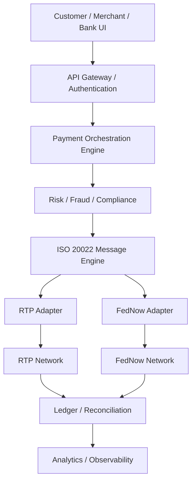

# Awesome-Real-Time-Payments-Platform

Edit
Top Real-Time Payments Platforms Ecosystem

Curated List of SaaS Products & Open-Source GitHub Projects
Focused on Instant Payments, RTP/FedNow, Payment Orchestration, ISO 20022, Banking APIs & Real-Time Money Movement
Last updated: August 2026

This repository tracks notable SaaS/hosted platforms and open-source projects for Real-Time Payments Platforms. These platforms enable banks, fintechs, enterprises, and payment providers to initiate, receive, route, process, reconcile, and monitor instant payments across domestic and cross-border payment rails.

Examples include Modern Treasury, Moov, Form3, Finzly, Volante Technologies, ACI Worldwide, Fiserv NOW, Finastra Payments To Go, ICON Solutions, and ClearBank.

Open-source emphasis: This section is heavily expanded with open-source payment infrastructure, ISO 20022 implementations, RTP/FedNow message libraries, payment gateways, ledger systems, banking APIs, payment orchestration components, and real-time transaction-processing projects. A particularly useful open-source ecosystem comes from Moov, which maintains projects for RTP, FedNow, Fedwire, ACH, ISO 20022, and other financial infrastructure components. Moov's rtp20022 repository specifically implements ISO 20022 messages for Real Time Payments and has been used for RTP certification releases.

Unlike commercial platforms, most open-source projects are building blocks rather than complete certified instant-payment switches. Connecting directly to production payment rails generally requires bank/participant relationships, certification, security controls, compliance, and access credentials.

Contributions welcome! Open a PR to add/update entries. Keep descriptions factual and link to official sites or repositories.

## Table of Contents

- [SaaS/Hosted Platforms](#saashosted-platforms)
- [Additional Notable SaaS / Hosted Platforms](#additional-notable-saas--hosted-platforms)
- [Open-Source GitHub Projects](#open-source-github-projects)
- [Additional Strong Open-Source Options](#additional-strong-open-source-options)
- [Building a Self-Hosted Real-Time Payments Stack](#building-a-self-hosted-real-time-payments-stack)
- [Core Real-Time Payments Functions](#core-real-time-payments-functions)
- [Real-Time Payment Processing Flow](#real-time-payment-processing-flow)
- [Real-Time Payments Ledger](#real-time-payments-ledger)
- [Payment Orchestration Layer](#payment-orchestration-layer)
- [ISO 20022 as the Messaging Foundation](#iso-20022-as-the-messaging-foundation)
- [Building a Modern Open-Source Payment Platform](#building-a-modern-open-source-payment-platform)
- [Recommended Open-Source Stack](#recommended-open-source-stack)
- [Commercial vs Open-Source Landscape](#commercial-vs-open-source-landscape)
- [How to Contribute](#how-to-contribute)
- [Disclaimer](#disclaimer)

## SaaS/Hosted Platforms

| Platform | Description | Supported Rails / Capabilities | Starting Pricing | Free Tier / Trial Limits |
| :--- | :--- | :--- | :--- | :--- |
| [Modern Treasury](https://www.moderntreasury.com/) | Payment operations platform providing automated payment infrastructure, ledgering, reconciliation, and multi-bank connectivity. | FedNow, RTP, ACH, Fedwire, Push-to-Card, ISO 20022, Real-Time Ledgers | Starting at ~$2,000–$5,000/month platform commitment + per-transfer fees (ACH: ~$0.10–$0.25, RTP/FedNow: ~$0.40–$0.75) | Free Developer Sandbox indefinitely with full API parity, mock banking endpoints, and simulated ledger flows (0 live production transactions) |
| [Moov](https://moov.io/) | Developer-first payments infrastructure platform supporting end-to-end money movement, wallet services, and direct payment rail APIs. | RTP, FedNow, ACH, Cards, Push-to-Card, Virtual Cards, KYC/KYB | $500/month minimum platform commitment; 0.95% per RTP/FedNow transfer ($0.50 min / $5.00 cap), $0.25–$0.40 per ACH, Interchange + 0.60% + $0.15 for card acceptance | Free Developer Sandbox access indefinitely with unlimited simulated API calls and test micro-deposits; live account requires $500/mo minimum |
| [Form3](https://www.form3.tech/) | Cloud-native Payments-as-a-Service platform delivering direct API access to central instant clearing schemes for banks and fintechs. | FedNow, RTP, UK Faster Payments, Bacs, CHAPS, SEPA Instant, ISO 20022 | Volume-tiered enterprise contracts starting from ~£3,000–£5,000/month baseline fee + ~£0.015 to £0.05 per processed transaction/message | Free Cloud Sandbox environment and payment scheme simulators provided to qualifying institutions during onboarding (no free live production transactions) |
| [Finzly](https://www.finzly.com/) | Payments-as-a-Service and payment hub (Payment Galaxy) connecting core banking infrastructure to modern instant payment networks. | FedNow, RTP, ACH, Fedwire, SWIFT, ISO 20022, FX, Smart Routing | Modular subscription starting at ~$3,500/month per core payment module (e.g., FedNow/RTP hub) + ~$0.05 to $0.15 per routed transaction | Free self-service Developer Sandbox portal with full API mock capabilities, webhooks, and ISO 20022 message test endpoints |
| [Volante Technologies](https://www.volantetech.com/) | Cloud-native payments processing and multi-rail orchestration platform specializing in ISO 20022 transformation and instant payments. | FedNow, RTP, SEPA Instant (RT1/TIPS), Faster Payments, Wires, ISO 20022 | PaaS subscription starting at ~$5,000/month baseline service fee + ~$0.03 to $0.08 per transaction (volume-tiered) | Free Developer Sandbox for ISO 20022 and instant payment validation; promotional 90-day pilot fee waivers available for select schemes |
| [ACI Worldwide](https://www.aciworldwide.com/) | Enterprise real-time payment switching, settlement, fraud surveillance, and mission-critical banking infrastructure. | Global RTP networks, FedNow, Faster Payments, SEPA Instant, Cards, RTGS | Enterprise PaaS/SaaS deployment contracts starting at ~$10,000/month platform baseline + ~$0.01 to $0.04 per switch transaction | 30 to 60-day free testing trial via ASSET (ACI Simulated Software Environment for Testing) for prospective enterprise institutions |
| [Fiserv NOW](https://www.fiserv.com/) | Real-time payments network exchange and core banking connectivity suite supporting instant transaction routing for financial institutions. | NOW Network, FedNow, RTP, Zelle, Debit Rails, ISO 20022 | Gateway connection packages starting at ~$2,500–$5,000/month base platform fee + ~$0.04 to $0.10 per instant payment transaction | Free developer account on Fiserv Developer Studio with sandbox mock API access (no live free production transactions) |
| [Finastra Payments To Go](https://www.finastra.com/) | Cloud-hosted end-to-end payment processing SaaS designed to modernize bank payment operations and support emerging schemes. | FedNow, RTP, SEPA Instant, UK Faster Payments, Bacs, ISO 20022 | "Pay-as-you-grow" subscription model starting from ~$4,000/month + ~$0.02 to $0.06 per cleared transaction | Free indefinite access to FusionFabric.cloud developer sandbox for API prototyping and testing with synthetic data |
| [ICON Solutions](https://www.iconsolutions.com/) | Icon Payments Framework (IPF) cloud payment orchestration architecture and microservices for real-time payments modernization. | FedNow, RTP, UK Faster Payments, SEPA Instant, ISO 20022 | Enterprise software/SaaS framework licensing starting at ~$7,500/month base fee + volume-based transaction tiers | 30-day technical evaluation period with free access to IPF test SDKs and architecture simulation tools for prospective banking clients |
| [ClearBank](https://clear.bank/) | Cloud-native clearing bank and Banking-as-a-Service infrastructure offering direct clearing and embedded multi-currency accounts. | UK Faster Payments, CHAPS, Bacs, SEPA Instant, Virtual Accounts | £5,000/month minimum platform/account fee + £0.05 to £0.20 per Faster Payments transaction | Free developer API Sandbox indefinitely with virtual bank account creation, simulated clearing webhooks, and test endpoints |

## Additional Notable SaaS / Hosted Platforms

| Platform | Description | Supported Rails / Capabilities | Starting Pricing | Free Tier / Trial Limits |
| :--- | :--- | :--- | :--- | :--- |
| [The Clearing House RTP](https://www.theclearinghouse.org/payment-systems/rtp) | U.S. national real-time payment network operated by The Clearing House for 24/7 instant clearing and settlement. | U.S. RTP network, ISO 20022 messages (pacs.008, pacs.002, pain.013 RfP) | $0.045 per customer credit transfer (paid by sender), $0.01 per Request for Payment (RfP), $0.00 admission fee, ~$250–$500/month pass-through network connectivity | Free admission ($0 join fee); testing facility (TCH test bench) provided during onboarding certification without per-test message fees |
| [FedNow](https://www.frbservices.org/financial-services/fednow) | Federal Reserve 24/7/365 instant payment rail enabling financial institutions to transfer funds immediately. | FedNow instant credit transfers, Request for Payment (RfP), Liquidity Transfers, ISO 20022 | $25.00/month participation fee per RTN (discounted to $0.00 through 2026), $0.045 per customer credit transfer, $0.01 per Request for Payment, $1.00 per liquidity transfer | $0.00/month participation fee discount active through 2026; first 2,500 customer credit transfers fee-waived ($0) per month; free certification testing environment |
| [Mastercard Send](https://developer.mastercard.com/mastercard-send/documentation/) | Global push-payment infrastructure enabling real-time fund transfers to cards and bank accounts. | Push-to-Card (Mastercard/Visa debit), P2P, B2C disbursements, Gov-to-Citizen payouts | Starting from ~$0.05–$0.15 + 0.05%–0.15% per push transaction + program enablement fees | Free indefinite access to Mastercard Developers Sandbox with simulated API keys, test card numbers, and mock webhook responses |
| [Visa Direct](https://developer.visa.com/capabilities/visa_direct) | Real-time payment network enabling funds to be pushed directly to eligible debit, credit, and prepaid cards globally. | OCT (Original Credit Transactions), AFT (Account Funding), Cross-Border push-to-account | Starting from ~$0.05–$0.15 + 0.05% per OCT push payment + processor acquiring fees | Free indefinite access to Visa Developer Platform Sandbox with test acquiring BINs, simulator tools, and mock card profiles |
| [Banking Circle](https://www.bankingcircle.com/) | Licensed financial utility providing global cross-border clearing, virtual IBANs, and real-time settlement rails. | SEPA Instant, Faster Payments, SWIFT, local clearing across 25+ currencies | Account maintenance starting from €1,000/month + local clearing fees from €0.10 to €0.35 per transaction | Free API Sandbox environment upon developer registration for testing virtual account issuance and multi-currency transfers |
| [Temenos](https://www.temenos.com/) | Cloud banking and payment processing engine supporting multi-rail instant clearing and core banking modernization. | FedNow, RTP, SEPA Instant, TIPS, Faster Payments, ISO 20022 | SaaS deployment tiers starting from ~$6,000/month baseline fee + volume-tiered processing rates (~$0.02–$0.05/tx) | 30-day free trial on Temenos Developer Portal sandbox with interactive banking API endpoints and mock test data |
| [FIS](https://www.fisglobal.com/) | Global enterprise payment switching, instant payments hub, and core banking technology infrastructure. | Real-Time Payments Hub, FedNow, RTP, Open Payment Framework, ISO 20022 | Enterprise SaaS master agreements starting from ~$8,000/month platform baseline + ~$0.02–$0.05 per processed transaction | Free "Code Connect Sandbox" evaluation tier with full API documentation and endpoint testing for registered developers |
| [Bottomline](https://www.bottomline.com/) | Cloud business payment automation, payment rail routing (PTX), and B2B electronic payment networks. | Faster Payments, Bacs, Fedwire, ACH, FedNow connectivity, Fraud defense | SaaS subscriptions starting from ~$1,500/month base + ~$0.15–$0.50 per automated B2B transaction | Free sandbox access for developer API integration testing and mock payment verification during pre-production onboarding |
| [ACI Speedpay](https://www.aciworldwide.com/solutions/aci-speedpay) | Real-time electronic bill presentment, multi-channel payment collection, and instant disbursement SaaS. | Push-to-Card, RTP, ACH, Debit/Credit cards, digital wallets | Transaction-based bill payment fee starting from ~$0.25–$1.50 per payment / disbursement (or baseline SaaS tier from ~$2,000/month) | Free sandbox testing via ASSET simulation platform during the evaluation period (typically 30–60 days) |
| [Paymentology](https://www.paymentology.com/) | Cloud-native card issuing and real-time payment processing platform for fintechs and digital banks. | Virtual & physical card issuance, Visa/Mastercard processing, multi-currency wallets, real-time ledgers | ~$1,000–$2,500/month platform base fee + ~$0.10–$0.25 per active virtual card + ~$0.02–$0.05 per transaction | Free developer sandbox with simulated card generation, instant webhook firing, and ledger testing tools |
| [Nium](https://www.nium.com/) | Global real-time money movement platform providing payout APIs, virtual card issuance, and FX rails. | Real-time payouts to 100+ countries, SEPA Instant, Faster Payments, PIX, FAST, Visa Direct | FX markup from 0.25% to 0.75% + local instant payout fees starting at ~$0.50–$2.00 per payout (with $500/month minimum volume tier) | Free sandbox access with pre-funded virtual test wallets, simulated beneficiary routing, and instant payout mock webhooks |
| [Thunes](https://www.thunes.com/) | Global B2B cross-border payment network connecting mobile wallets, bank accounts, and alternative payment methods. | Instant payouts to 3B+ mobile wallets and 4B+ bank accounts across 130+ countries | Direct corridor fees starting at ~$0.75–$2.50 per transfer + 0.30%–0.80% FX spread (volume-tiered) | Free developer sandbox access with mock currency corridors, mobile wallet simulation, and automated test webhooks |
| [Airwallex](https://www.airwallex.com/) | Global financial platform and API infrastructure for multi-currency accounts, instant payouts, and card issuing. | Real-time local clearing in 110+ countries, Faster Payments, SEPA Instant, ACH, Fedwire, Card Issuing | $0/month (Explore Plan); FX markup starting at 0.5%–1.0% above interbank; local payouts free to $0.50/tx; SWIFT wires $15–$25 | Free Forever Explore plan ($0/month) includes multi-currency accounts in 20+ currencies, up to 5 free virtual company cards, and 0 monthly maintenance fees |
| [Adyen](https://www.adyen.com/) | Global payment processing platform providing end-to-end acquiring, real-time payouts, and issuing infrastructure. | Global credit/debit cards, RTP, FedNow, SEPA Instant, Faster Payments, local payment methods | $0.13 (€0.11) fixed processing fee per transaction + Interchange++ (e.g., Visa/Mastercard IC++ + $0.13, ACH/RTP ~$0.25) | Free indefinite test account and sandbox environment with complete API suite, simulated settlement webhooks, and mock payment methods |
| [Stripe](https://stripe.com/) | Programmable financial infrastructure and payment processing platform with real-time payout capabilities. | Cards, Instant Payouts (Visa Direct/Mastercard Send), ACH Direct Debit, FedNow, RTP, SEPA, Financial Connections | 2.9% + $0.30 per domestic card transaction; 1.5% (min $0.50) for Instant Payouts; 0.8% ($5.00 cap) for ACH Direct Debit; $0/month account fee | Free Forever pay-as-you-go account ($0/month subscription) with 100% free test mode / sandbox environment; unlimited test API calls and webhooks |
| [Checkout.com](https://www.checkout.com/) | Enterprise cloud payment processor offering global acquiring, payment routing, and real-time payout solutions. | Cards, Real-Time Payouts, Apple Pay, Google Pay, local clearing rails in 50+ countries | Interchange++ or starting flat rate from 0.95% + $0.10 / €0.02–€0.20 per transaction (with typical $500/month minimum volume tier) | Free developer sandbox environment available upon registration with test API keys, simulator tools, and mock card testing |

## Open-Source GitHub Projects

### Moov RTP 20022
Open-source Go implementation of ISO 20022 messages for U.S. Real Time Payments. The project contains message structures for RTP and has been used to support RTP certification releases.

### Moov FedNow 20022
Open-source Go implementation containing ISO 20022 message definitions for FedNow payments, providing a useful building block for FedNow integrations.

### Moov ISO 20022
Open-source Go library and HTTP tooling for creating, parsing, validating, and converting ISO 20022 messages. The project is being superseded by more targeted repositories such as rtp20022.

### Moov Fedwire 20022
Open-source ISO 20022 message implementation for Fedwire Funds Service integrations.

### OpenFedNow
Open-source middleware architecture for connecting legacy core banking systems with FedNow and RTP. It includes ISO 20022 models, transaction orchestration, idempotency, fraud pre-screening, a shadow ledger, sandbox adapters, and legacy-core adapters.

### Moov ACH
Open-source financial infrastructure for generating, parsing, validating, and processing ACH files and transactions.

### Moov Wire
Open-source Fedwire file-processing library for legacy FAIM formats. Fedwire moved to ISO 20022 in July 2025, so this project is now primarily useful for historical files, migration, and archival processing.

### Moov Paygate
Open-source REST API infrastructure for processing electronic payments without requiring applications to directly understand underlying payment-file specifications.

### Moov Watchman
Open-source financial compliance infrastructure for searching sanctions and related watchlists.

### Moov Fed
Open-source utilities for interacting with Federal Reserve-related financial institution and routing information.

### Moov Accounts
Open-source banking-account and financial-infrastructure building blocks within the Moov ecosystem.

### Moov Money
Moov's broader open-source ecosystem provides individual components for payment processing, banking integrations, financial messaging, compliance, and money movement.

## Additional Strong Open-Source Options

- **Apache Fineract** — Open-source core banking platform that can serve as a foundation around which payment infrastructure can be integrated.
- **Mifos X / Fineract** — Open-source financial-services and core-banking ecosystem.
- **ERPNext** — Open-source ERP with accounting and payment-related capabilities.
- **Kill Bill** — Open-source payments, billing, and subscription platform.
- **Medusa** — Open-source commerce infrastructure with extensible payment integrations.
- **Apache Camel** — Integration framework useful for connecting banking/payment systems and message-processing pipelines.
- **Apache Kafka** — Distributed event-streaming infrastructure suitable for real-time payment-event processing.
- **Temporal** — Open-source durable workflow engine useful for payment orchestration and long-running transaction workflows.
- **Debezium** — Open-source CDC platform useful for streaming core-banking and payment data into real-time processing systems.
- **PostgreSQL** — Open-source transactional database suitable for payment ledgers and transaction state.
- **Redis** — In-memory data infrastructure useful for idempotency, caching, rate limits, and real-time payment processing.
- **Keycloak** — Open-source identity and access management for payment APIs and banking applications.
- **OpenTelemetry** — Open-source observability framework for tracing payment transactions across distributed systems.

## Building a Self-Hosted Real-Time Payments Stack

A practical open-source real-time payments architecture can combine:

```
API Gateway → Payment Orchestrator → ISO 20022 Engine → Rail Adapter → RTP/FedNow
```

with:

```
Core Banking → Ledger → Event Bus → Reconciliation → Fraud/Risk → Notifications
```

The architecture can be implemented using open-source components such as:

> **Moov RTP 20022 + Moov FedNow 20022 + Temporal + Kafka + PostgreSQL + Redis + OpenTelemetry**

This does not constitute a complete certified replacement for a commercial payment switch, but it provides many of the software building blocks needed to construct one.

## Core Real-Time Payments Functions

- **Payment Initiation** — APIs for creating instant payment instructions.
- **Payment Routing** — Determine the appropriate payment rail and participant.
- **Payment Orchestration** — Coordinate multi-step payment workflows.
- **ISO 20022 Processing** — Generate, parse, validate, and transform financial messages.
- **RTP Processing** — Support The Clearing House RTP message flows.
- **FedNow Processing** — Support Federal Reserve instant-payment message flows.
- **Payment Status Tracking** — Track transactions from initiation through settlement.
- **Idempotency** — Prevent duplicate payment execution.
- **Ledgering** — Maintain real-time balances and transaction state.
- **Fraud Screening** — Apply transaction-level risk rules before execution.
- **Sanctions Screening** — Screen participants against relevant watchlists.
- **Account Validation** — Validate beneficiary and account information.
- **Payment Limits** — Enforce customer, account, and transaction limits.
- **Liquidity Management** — Monitor available liquidity for instant settlement.
- **Exception Handling** — Handle rejects, returns, timeouts, cancellations, and reversals.
- **Reconciliation** — Reconcile payment-rail transactions with the core ledger.
- **Notifications** — Generate real-time transaction notifications.
- **Auditability** — Maintain immutable payment and state-transition records.
- **Observability** — Trace payment transactions across distributed services.
- **High Availability** — Operate continuously because instant-payment rails are available around the clock.
- **Disaster Recovery** — Maintain resilient processing across infrastructure failures.
- **Payment Analytics** — Analyze transaction volumes, latency, failure rates, and fraud patterns.

## Real-Time Payment Processing Flow

A typical instant-payment flow can be modeled as:

```
Customer → API → Authentication → Risk/Fraud → Account Validation → Payment Orchestrator → ISO 20022 → RTP/FedNow Adapter → Payment Rail → Receiving Institution → Confirmation
```

The transaction state can then flow through:

```
Initiated → Validated → Risk Approved → Submitted → Accepted → Settled → Reconciled
```

with alternative paths such as:

```
Rejected → Returned → Reversed → Exception Queue
```

## Real-Time Payments Ledger

A robust system should maintain a transactional ledger independently from payment-rail messaging:

```
Payment Request → Ledger Reservation → Rail Submission → Settlement Confirmation → Ledger Commit
```

This separation makes it possible to maintain consistent financial state even when external payment networks or legacy core systems respond asynchronously.

## Payment Orchestration Layer

A payment orchestration layer can abstract multiple rails behind a single internal API:

```
Unified Payment API
├── RTP
├── FedNow
├── ACH
├── Fedwire
├── Visa Direct
├── Mastercard Send
├── SEPA Instant
├── Faster Payments
├── PIX
├── UPI
└── Other domestic instant-payment schemes
```

This allows applications to initiate payments without embedding every rail's proprietary integration into the business logic.

## ISO 20022 as the Messaging Foundation

ISO 20022 is particularly important for modern real-time payment infrastructure because it provides standardized financial messaging across payment networks.

Open-source libraries such as Moov RTP 20022 and Moov FedNow 20022 provide reusable implementations for payment-message processing.

Typical payment messages include:
- `pacs.008` — Financial Institution to Financial Institution Customer Credit Transfer
- `pacs.002` — Payment Status Report
- `pacs.004` — Payment Return
- `camt.056` — Payment Cancellation Request
- `camt.029` — Resolution of Investigation
- Other `pacs`, `camt`, and related ISO 20022 message families

## Building a Modern Open-Source Payment Platform



## Recommended Open-Source Stack

- **U.S. Instant-Payments Stack:** Moov RTP 20022 + Moov FedNow 20022 + OpenFedNow + PostgreSQL + Kafka + Temporal + Redis + OpenTelemetry
- **Payment Messaging:** Moov ISO 20022 + RTP 20022 + FedNow 20022
- **Workflow Orchestration:** Temporal + Kafka
- **Ledgering:** PostgreSQL + application-level double-entry ledger
- **API Infrastructure:** Kong / Envoy + Keycloak + REST/gRPC
- **Observability:** OpenTelemetry + Prometheus + Grafana
- **Compliance:** Moov Watchman + custom transaction-risk engine

## Commercial vs Open-Source Landscape

The commercial platforms in this category generally provide the difficult operational layer around:
- Payment-network connectivity & scheme certification
- Bank integrations & compliance
- High availability & 24/7 disaster recovery
- Fraud screening & operational dashboards
- Production support & regulatory alignment

Open-source projects tend to focus on individual technical layers:
```
ISO 20022 → Payment APIs → Message Processing → Orchestration → Ledger → Event Streaming → Compliance → Observability
```

Therefore, the strongest open-source strategy is generally compositional rather than looking for a single "open-source Modern Treasury/Volante/ACI" equivalent.

## How to Contribute

1. Fork the repo.
2. Add/edit entries in README.md (follow existing tabular and list formats).
3. Include: name, link, description, supported payment rails, and pricing/free tier details where applicable.
4. Prefer actively maintained projects with public repositories.
5. Clearly distinguish between fully open-source, open-core, source-available, research software, and commercial products.
6. Specify supported payment rails such as RTP, FedNow, Fedwire, ACH, SEPA Instant, Faster Payments, PIX, UPI, Visa Direct, or Mastercard Send where applicable.
7. Include ISO 20022 message families supported by payment projects where known.
8. Submit PR with a short explanation.
9. Star the repo if you find it useful!

## Disclaimer

- This is a community-curated list — not exhaustive and not an endorsement.
- Real-time payment processing is highly regulated and generally requires participation agreements, certifications, security controls, and appropriate banking/payment licenses.
- Open-source libraries and frameworks listed here are generally components or building blocks rather than certified production payment switches.
- Connecting directly to RTP, FedNow, Fedwire, or other payment networks requires appropriate participant/vendor arrangements.
- Payment systems require strong controls around authentication, authorization, encryption, fraud detection, sanctions screening, transaction limits, auditability, reconciliation, and operational resilience.
- Financial ledgers should use appropriate transactional guarantees and should not depend solely on asynchronous messaging state.
- Instant payment systems operate continuously, making high availability, monitoring, disaster recovery, and operational response particularly important.
- Always verify the current license, maintenance status, payment-network specifications, and production-readiness of open-source projects before deployment.

---
Made for banks, fintechs, payment processors, financial institutions, treasury teams, developers, and organizations building modern instant-payment infrastructure.  
Let's make real-time payments more programmable, interoperable, transparent, and developer-friendly.
