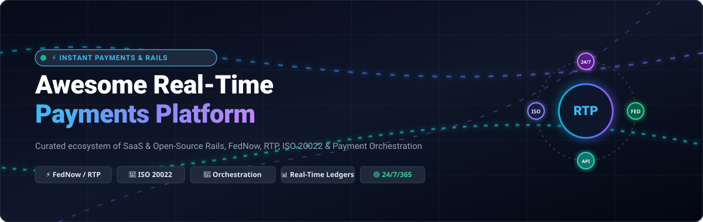
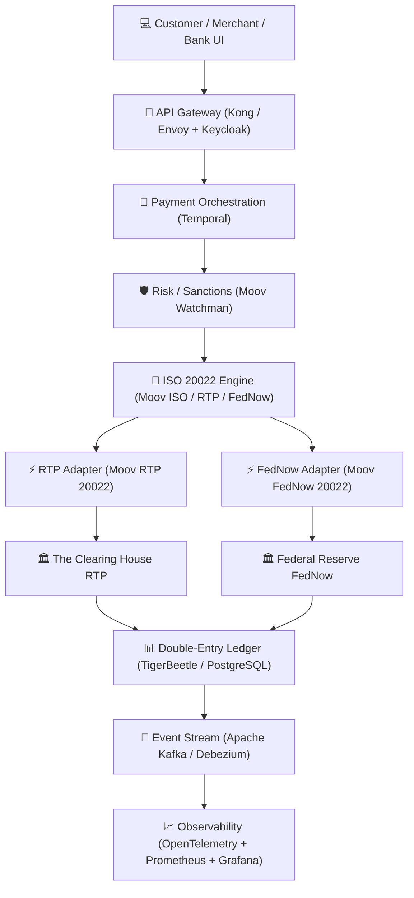
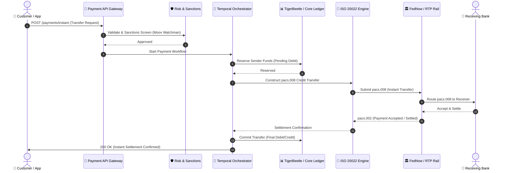

# ⚡ Awesome Real-Time Payments Platform

<div align="center">

<a href="https://github.com/ishandutta2007/Awesome-Awesome-Awesome"></a><a href="https://discord.gg/jc4xtF58Ve"></a>
<a href="https://github.com/ishandutta2007/Awesome-Real-Time-Payments-Platform/stargazers"></a>
<a href="https://github.com/ishandutta2007/Awesome-Real-Time-Payments-Platform/network/members"></a>
<a href="https://github.com/ishandutta2007/Awesome-Real-Time-Payments-Platform/pulls"></a>
<a href="https://github.com/ishandutta2007/Awesome-Real-Time-Payments-Platform/blob/main/LICENSE"></a>
<a href="https://github.com/ishandutta2007"></a>

<br/><br/>

[](https://github.com/ishandutta2007/Awesome-Real-Time-Payments-Platform)

**Curated ecosystem of SaaS Products & Open-Source Projects for Instant Payments, FedNow, RTP, ISO 20022, Payment Orchestration & Real-Time Money Movement.**

*Last updated: August 2026*

</div>

---

## 🧭 Overview & Architecture Scope

This repository is an authoritative directory tracking enterprise SaaS/hosted platforms and high-performance open-source projects for **Real-Time Payments (RTP)** and **Instant Money Movement**. These platforms enable banks, fintechs, neobanks, payment processors, and treasury teams to initiate, route, settle, reconcile, and audit payments 24/7/365 across domestic and cross-border payment rails.

Key payment schemes and standards covered:
- 🇺🇸 **United States:** The Clearing House RTP®, Federal Reserve FedNow®, Fedwire Funds Service (ISO 20022), Same-Day ACH, Visa Direct, Mastercard Send
- 🇪🇺 **Europe & UK:** SEPA Instant Credit Transfer (SCT Inst), TIPS, RT1, UK Faster Payments (NPA), Bacs, CHAPS
- 🌎 **Global & Latin America / Asia:** Pix (Brazil), UPI (India), FAST (Singapore), PromptPay (Thailand)
- 📜 **Messaging & Formats:** ISO 20022 (`pacs.008`, `pacs.002`, `pacs.004`, `pain.013`, `camt.056`), JSON-based Banking APIs, Webhooks, Event Streams

---

## 📑 Table of Contents

- [📊 SaaS/Hosted Platforms](#-saashosted-platforms)
- [💻 Open-Source GitHub Projects](#-open-source-github-projects)
- [🛠️ Additional Open-Source Infrastructure](#️-additional-open-source-infrastructure)
- [🏗️ Building a Self-Hosted Real-Time Payments Stack](#️-building-a-self-hosted-real-time-payments-stack)
- [⚙️ Core Real-Time Payments Functions](#️-core-real-time-payments-functions)
- [🔄 Real-Time Payment Processing Flow](#-real-time-payment-processing-flow)
- [📖 ISO 20022 Messaging Standard](#-iso-20022-messaging-standard)
- [⚖️ Commercial vs Open-Source Comparison](#️-commercial-vs-open-source-comparison)
- [📈 Star History](#-star-history)
- [🤝 How to Contribute](#-how-to-contribute)
- [⚠️ Disclaimer](#️-disclaimer)

---

## 📊 SaaS/Hosted Platforms

> **📈 Sector Overview & Market Dynamics:** The global real-time payments market is estimated at **$32.5 Billion in 2026** (projected to surpass **$125+ Billion by 2032** growing at a 31.8% CAGR). The ecosystem displays a **bifurcated market concentration**: the core clearing and settlement infrastructure layer is **highly concentrated and utility-driven** (operated as natural monopolies or sovereign utilities like The Clearing House RTP, Federal Reserve FedNow, Visa, and Mastercard), whereas the payment orchestration, SaaS enablement, and cross-border money movement layers remain **moderately-to-highly fragmented** with strong competition among fintechs, banking software suites, and cloud payment gateways.

All entries below are sorted descending by **Company Size (Market Cap / Valuation / Revenue)**.

| Platform | Company Size (Valuation / Cap) | Focus & Core Description | Supported Rails / Capabilities | Starting Pricing | Free Tier / Trial Limits |
| :--- | :--- | :--- | :--- | :--- | :--- |
| [Visa Direct](https://developer.visa.com/capabilities/visa_direct) | 🏦 **Market Cap: ~$570 Billion** *(Revenue: ~$35.9B)* | Global push-to-card and real-time account payout network enabling instantaneous fund transfers to billions of endpoints. | OCT (Original Credit Transactions), AFT, Cross-Border Payouts, Digital Wallets | ~$0.05–$0.15 + 0.05% per OCT push payment + processor acquiring fees | Free Developer Platform Sandbox indefinitely with test acquiring BINs, transaction simulators, and test profiles |
| [Mastercard Send](https://developer.mastercard.com/mastercard-send/documentation/) | 🏦 **Market Cap: ~$440 Billion** *(Revenue: ~$25.1B)* | Global push-payment infrastructure facilitating instantaneous disbursement to debit cards, prepaid cards, and bank accounts. | Push-to-Card (Mastercard/Visa), P2P, B2C Disbursements, Gov-to-Citizen | Starting from ~$0.05–$0.15 + 0.05%–0.15% per push transaction + enablement fees | Free indefinite access to Mastercard Developers Sandbox with simulated API keys and mock webhook delivery |
| [Fiserv NOW](https://www.fiserv.com/) | 🏢 **Market Cap: ~$95 Billion** *(Revenue: ~$19.1B)* | Real-time payments network exchange and core banking connectivity suite for instant bank-to-bank transaction routing. | NOW Network, FedNow, RTP, Zelle, Debit Rails, ISO 20022 | Gateway packages starting at ~$2,500–$5,000/mo base platform fee + ~$0.04–$0.10 per instant payment | Free developer account on Fiserv Developer Studio with sandbox mock API access (0 free live transactions) |
| [Stripe](https://stripe.com/) | 🦄 **Valuation: ~$70 Billion** *(Revenue: ~$16.1B)* | Programmable financial infrastructure and payment processing platform with instantaneous push payouts and multi-rail routing. | Cards, Instant Payouts (Visa Direct/Mastercard Send), ACH Direct Debit, FedNow, RTP, SEPA | 2.9% + $0.30 per card charge; 1.5% (min $0.50) for Instant Payouts; 0.8% ($5 max) for ACH; $0/mo account fee | Free Forever pay-as-you-go account ($0/mo subscription) with 100% free test mode / sandbox environment; unlimited test API calls |
| [Adyen](https://www.adyen.com/) | 🏢 **Market Cap: ~$45 Billion** *(Revenue: ~$10.2B Gross)* | Global payment processing platform providing end-to-end acquiring, real-time payouts, issuing, and risk management. | Global cards, RTP, FedNow, SEPA Instant, Faster Payments, local payment rails | $0.13 (€0.11) fixed processing fee per transaction + Interchange++ (or rail fee, e.g. ACH/RTP ~$0.25) | Free indefinite test account and sandbox environment with complete API suite, test cards, and simulated settlement |
| [FIS](https://www.fisglobal.com/) | 🏢 **Market Cap: ~$45 Billion** *(Revenue: ~$9.8B)* | Global enterprise payment switching, instant payments hub, and core banking technology provider for top-tier institutions. | Real-Time Payments Hub, FedNow, RTP, Open Payment Framework, ISO 20022 | Enterprise SaaS master agreements starting from ~$8,000/mo platform baseline + ~$0.02–$0.05/tx | Free "Code Connect Sandbox" evaluation tier with full API documentation and endpoint testing for registered developers |
| [Checkout.com](https://www.checkout.com/) | 🦄 **Valuation: ~$11 Billion** *(Revenue: ~$300M+)* | Enterprise cloud payment processor delivering high-throughput global acquiring, smart routing, and real-time payouts. | Cards, Real-Time Payouts, Apple Pay, Google Pay, local clearing in 50+ countries | Interchange++ or starting flat rate from 0.95% + $0.10 / €0.02–€0.20 per transaction ($500/mo min volume) | Free developer sandbox environment upon registration with test API keys, simulator tools, and mock card testing |
| [Finastra Payments To Go](https://www.finastra.com/) | 🏢 **Valuation: ~$7.0 Billion** *(Revenue: ~$1.9B)* | Cloud-hosted end-to-end payment processing SaaS for financial institutions modernizing clearing operations. | FedNow, RTP, SEPA Instant, UK Faster Payments, Bacs, ISO 20022 | "Pay-as-you-grow" subscription starting from ~$4,000/month + ~$0.02 to $0.06 per cleared transaction | Free indefinite access to FusionFabric.cloud developer sandbox for API prototyping and testing with synthetic data |
| [Airwallex](https://www.airwallex.com/) | 🦄 **Valuation: ~$5.6 Billion** *(Revenue: ~$500M+)* | Global financial platform and API infrastructure for multi-currency accounts, instant cross-border payouts, and card issuing. | Real-time local clearing in 110+ countries, Faster Payments, SEPA Instant, ACH, Fedwire | $0/month (Explore Plan); FX markup starting at 0.5%–1.0% above interbank; local payouts free to $0.50/tx | Free Forever Explore plan ($0/mo) includes multi-currency accounts in 20+ currencies, 5 free virtual cards, and $0 maintenance fees |
| [Temenos](https://www.temenos.com/) | 🏢 **Market Cap: ~$5.5 Billion** *(Revenue: ~$1.0B)* | Cloud banking and payment processing engine supporting multi-rail instant clearing and core banking transformation. | FedNow, RTP, SEPA Instant, TIPS, Faster Payments, ISO 20022 | SaaS deployment tiers starting from ~$6,000/mo baseline fee + volume-tiered rates (~$0.02–$0.05/tx) | 30-day free trial on Temenos Developer Portal sandbox with interactive banking API endpoints and mock core data |
| [ACI Worldwide / Speedpay](https://www.aciworldwide.com/) | 🏢 **Market Cap: ~$5.0 Billion** *(Revenue: ~$1.5B)* | Enterprise real-time payment switching, settlement, bill presentment, and instant disbursement software. | Global RTP networks, FedNow, Faster Payments, SEPA Instant, Cards, RTGS | Enterprise PaaS/SaaS contracts starting at ~$10,000/mo base + ~$0.01–$0.04 per switch transaction | 30 to 60-day free testing trial via ASSET (ACI Simulated Software Environment for Testing) for enterprise evaluations |
| [The Clearing House RTP](https://www.theclearinghouse.org/payment-systems/rtp) | 🏛️ **Consortium Backed** *(Multi-Trillion Asset Backing)* | U.S. national real-time payment network operated by The Clearing House for 24/7 instant clearing and immediate settlement. | U.S. RTP network, ISO 20022 messages (`pacs.008`, `pacs.002`, `pain.013` RfP) | $0.045 per customer credit transfer, $0.01 per Request for Payment (RfP), $0.00 admission fee | Free admission ($0 join fee); testing facility (TCH test bench) provided during onboarding certification |
| [FedNow](https://www.frbservices.org/financial-services/fednow) | 🏛️ **Central Bank Service** *(Federal Reserve System)* | U.S. Federal Reserve 24/7/365 instant payment rail enabling depository institutions to transfer funds immediately. | FedNow credit transfers, Request for Payment (RfP), Liquidity Transfers, ISO 20022 | $25.00/mo participation fee per RTN (discounted to $0.00 through 2026), $0.045 per credit transfer, $0.01 per RfP | $0.00/mo participation fee discount through 2026; first 2,500 customer credit transfers fee-waived ($0) monthly; free test bench |
| [Bottomline](https://www.bottomline.com/) | 🏢 **Valuation: ~$2.6 Billion** *(Revenue: ~$500M+)* | Cloud business payment automation, payment rail routing (PTX), and B2B electronic payment networks. | Faster Payments, Bacs, Fedwire, ACH, FedNow connectivity, Fraud defense | SaaS subscriptions starting from ~$1,500/month base + ~$0.15–$0.50 per automated B2B transaction | Free sandbox access for developer API integration testing and mock payment verification during pre-production |
| [Modern Treasury](https://www.moderntreasury.com/) | 🦄 **Valuation: ~$2.1 Billion** *(Revenue: ~$50M+)* | Payment operations platform providing automated payment infrastructure, multi-bank ledgering, and instant reconciliation. | FedNow, RTP, ACH, Fedwire, Push-to-Card, ISO 20022, Real-Time Ledgers | Starting at ~$2,000–$5,000/mo platform commitment + per-transfer fees (ACH: ~$0.10–$0.25, RTP/FedNow: ~$0.40–$0.75) | Free Developer Sandbox indefinitely with full API parity, mock banking endpoints, and simulated ledger flows (0 live transactions) |
| [Banking Circle](https://www.bankingcircle.com/) | 🏢 **Valuation: ~$2.0 Billion+** *(Revenue: ~$150M+)* | Fully licensed financial utility providing global cross-border clearing, virtual IBANs, and real-time settlement rails. | SEPA Instant, Faster Payments, SWIFT, local clearing across 25+ currencies | Account maintenance starting from €1,000/month + local clearing fees from €0.10 to €0.35 per transaction | Free API Sandbox environment upon developer registration for testing virtual account issuance and multi-currency flows |
| [Nium](https://www.nium.com/) | 🦄 **Valuation: ~$2.0 Billion** *(Revenue: ~$150M+)* | Global real-time money movement platform providing payout APIs, virtual card issuance, and embedded FX rails. | Instant payouts to 100+ countries, SEPA Instant, Faster Payments, PIX, FAST, Visa Direct | FX markup from 0.25% to 0.75% + local instant payout fees starting at ~$0.50–$2.00 per payout ($500/mo min) | Free sandbox access with pre-funded virtual test wallets, simulated beneficiary routing, and instant payout mock webhooks |
| [ClearBank](https://clear.bank/) | 🦄 **Valuation: ~$1.0 Billion** *(Revenue: ~$140M+)* | Cloud-native clearing bank and Banking-as-a-Service infrastructure offering direct clearing and embedded bank accounts. | UK Faster Payments, CHAPS, Bacs, SEPA Instant, Virtual Accounts | £5,000/month minimum platform/account fee + £0.05 to £0.20 per Faster Payments transaction | Free developer API Sandbox indefinitely with virtual bank account creation, simulated clearing webhooks, and test endpoints |
| [Thunes](https://www.thunes.com/) | 🦄 **Valuation: ~$900 Million** *(Revenue: ~$100M+)* | Global B2B cross-border payment network connecting mobile wallets, bank accounts, and alternative payment methods. | Instant payouts to 3B+ mobile wallets and 4B+ bank accounts across 130+ countries | Direct corridor fees starting at ~$0.75–$2.50 per transfer + 0.30%–0.80% FX spread (volume-tiered) | Free developer sandbox access with mock currency corridors, mobile wallet simulation, and automated test webhooks |
| [Form3](https://www.form3.tech/) | 🏢 **Valuation: ~$600 Million** *(Revenue: ~$45M+)* | Cloud-native Payments-as-a-Service delivering direct API access to central instant clearing schemes for banks and fintechs. | FedNow, RTP, UK Faster Payments, Bacs, CHAPS, SEPA Instant, ISO 20022 | Volume-tiered enterprise contracts starting from ~£3,000–£5,000/mo baseline + ~£0.015–£0.05 per processed transaction | Free Cloud Sandbox environment and payment scheme simulators provided to qualifying institutions during onboarding |
| [Volante Technologies](https://www.volantetech.com/) | 🏢 **Valuation: ~$500 Million** *(Revenue: ~$100M+)* | Cloud-native payments processing and multi-rail orchestration platform specializing in ISO 20022 transformation and PaaS. | FedNow, RTP, SEPA Instant (RT1/TIPS), Faster Payments, Wires, ISO 20022 | PaaS subscription starting at ~$5,000/month baseline service fee + ~$0.03 to $0.08 per transaction (volume-tiered) | Free Developer Sandbox for ISO 20022 and instant payment validation; promotional 90-day pilot fee waivers available |
| [Moov](https://moov.io/) | 🦄 **Valuation: ~$350 Million** *(Revenue: ~$30M+)* | Developer-first payments infrastructure platform supporting end-to-end money movement, wallet services, and direct rail APIs. | RTP, FedNow, ACH, Cards, Push-to-Card, Virtual Cards, KYC/KYB | $500/month minimum platform commitment; 0.95% per RTP/FedNow transfer ($0.50 min / $5.00 cap), $0.25–$0.40 per ACH | Free Developer Sandbox access indefinitely with unlimited simulated API calls and test micro-deposits; live account requires $500/mo |
| [Paymentology](https://www.paymentology.com/) | 🏢 **Valuation: ~$300 Million** *(Revenue: ~$50M+)* | Cloud-native card issuing and real-time payment processing platform for fintechs and digital banks globally. | Virtual & physical card issuance, Visa/Mastercard processing, multi-currency wallets | ~$1,000–$2,500/mo platform base fee + ~$0.10–$0.25 per active virtual card + ~$0.02–$0.05 per transaction | Free developer sandbox with simulated card generation, instant webhook firing, and ledger testing tools |
| [Finzly](https://www.finzly.com/) | 🏢 **Valuation: ~$150 Million** *(Revenue: ~$30M+)* | Payments-as-a-Service and payment hub (Payment Galaxy) connecting core banking infrastructure to instant networks. | FedNow, RTP, ACH, Fedwire, SWIFT, ISO 20022, FX, Smart Routing | Modular subscription starting at ~$3,500/mo per core payment module (e.g., FedNow/RTP hub) + ~$0.05–$0.15/tx | Free self-service Developer Sandbox portal with full API mock capabilities, webhooks, and ISO 20022 test endpoints |
| [ICON Solutions](https://www.iconsolutions.com/) | 🏢 **Valuation: ~$100 Million** *(Revenue: ~$25M+)* | Icon Payments Framework (IPF) cloud payment orchestration architecture and microservices for real-time payments. | FedNow, RTP, UK Faster Payments, SEPA Instant, ISO 20022 | Enterprise software/SaaS framework licensing starting at ~$7,500/month base fee + volume-based transaction tiers | 30-day technical evaluation period with free access to IPF test SDKs and architecture simulation tools for banking clients |

---

## 💻 Open-Source GitHub Projects

The following table lists dedicated open-source projects for payment infrastructure, ISO 20022 messaging, clearing gateways, financial ledgers, and compliance engines.

All projects are sorted descending by **GitHub Star Count** with direct links to their stargazers page.

| Repository | GitHub Stars | Primary Language | Description & Key Features |
| :--- | :--- | :--- | :--- |
| [redis/redis](https://github.com/redis/redis) | [](https://github.com/redis/redis/stargazers) | C | In-memory key-value data structure store used extensively in real-time payments for idempotency locking, sub-millisecond account balance caching, rate-limiting, and distributed session states. |
| [apache/kafka](https://github.com/apache/kafka) | [](https://github.com/apache/kafka/stargazers) | Java / Scala | Distributed event streaming platform providing partitioned, fault-tolerant, high-throughput message logs for real-time payment events, audit streams, and real-time fraud monitoring. |
| [temporalio/temporal](https://github.com/temporalio/temporal) | [](https://github.com/temporalio/temporal/stargazers) | Go | Microservice orchestration and durable workflow engine ideal for orchestrating multi-step real-time payment sagas, automated compensations, timeouts, and state machines. |
| [medusajs/medusa](https://github.com/medusajs/medusa) | [](https://github.com/medusajs/medusa/stargazers) | TypeScript | Modular commerce engine with extensible multi-provider payment plugins, webhook orchestration, and real-time checkout flows. |
| [keycloak/keycloak](https://github.com/keycloak/keycloak) | [](https://github.com/keycloak/keycloak/stargazers) | Java | Open-source Identity and Access Management (IAM) supporting OAuth 2.0, OpenID Connect (OIDC), mTLS, and Fine-Grained Authorization for banking and payment APIs. |
| [frappe/erpnext](https://github.com/frappe/erpnext) | [](https://github.com/frappe/erpnext/stargazers) | Python / JS | Full-featured ERP with double-entry general ledger, automated bank reconciliation, multi-currency accounting, and payment entry management. |
| [postgres/postgres](https://github.com/postgres/postgres) | [](https://github.com/postgres/postgres/stargazers) | C | World-class ACID-compliant relational database system acting as the foundational transactional system of record for payment ledgers, account balances, and immutable audit logs. |
| [debezium/debezium](https://github.com/debezium/debezium) | [](https://github.com/debezium/debezium/stargazers) | Java | Distributed Change Data Capture (CDC) platform capturing row-level database changes to feed transactional data into real-time payment event streams and downstream ledgers. |
| [tigerbeetledb/tigerbeetle](https://github.com/tigerbeetledb/tigerbeetle) | [](https://github.com/tigerbeetledb/tigerbeetle/stargazers) | Zig | Purpose-built, high-throughput distributed financial accounting database designed specifically for real-time tracking of balances and transfers with deterministic safety guarantees. |
| [apache/camel](https://github.com/apache/camel) | [](https://github.com/apache/camel/stargazers) | Java | Versatile integration framework providing enterprise integration patterns (EIPs) and 300+ connectors for banking protocols, ISO 20022 message transformation, and payment queues. |
| [killbill/killbill](https://github.com/killbill/killbill) | [](https://github.com/killbill/killbill/stargazers) | Java | Open-source billing and payment routing platform supporting recurring payments, invoice generation, payment gateways, and custom payment routing plugins. |
| [open-telemetry/opentelemetry-collector](https://github.com/open-telemetry/opentelemetry-collector) | [](https://github.com/open-telemetry/opentelemetry-collector/stargazers) | Go | Vendor-agnostic telemetry collector for distributed tracing, metrics, and log aggregation across payment gateways, rail adapters, and core ledger services. |
| [moov-io/ach](https://github.com/moov-io/ach) | [](https://github.com/moov-io/ach/stargazers) | Go | Comprehensive, battle-tested Go library for reading, validating, and generating NACHA compliant Automated Clearing House (ACH) files. |
| [apache/fineract](https://github.com/apache/fineract) | [](https://github.com/apache/fineract/stargazers) | Java | Cloud-native core banking system with REST APIs for customer accounts, loans, deposits, ledger accounting, and real-time transaction processing. |
| [formancehq/stack](https://github.com/formancehq/stack) | [](https://github.com/formancehq/stack/stargazers) | Go / TypeScript | Programmable money movement and double-entry ledger platform with Numscript DSL for modeling complex multi-party financial transactions and payouts. |
| [apache/streampipes](https://github.com/apache/streampipes) | [](https://github.com/apache/streampipes/stargazers) | Java / TypeScript | Self-service real-time data streaming and complex event processing (CEP) engine for transaction stream analytics, anomaly detection, and fraud surveillance. |
| [moov-io/paygate](https://github.com/moov-io/paygate) | [](https://github.com/moov-io/paygate/stargazers) | Go | Open-source REST API gateway for orchestrating payment instructions and multi-rail money transfers without manual file handling. |
| [moov-io/watchman](https://github.com/moov-io/watchman) | [](https://github.com/moov-io/watchman/stargazers) | Go | High-speed sanctions and AML watchlist screening engine downloading and indexing OFAC, PEP, BIS, EU, and UN lists with exact and fuzzy matching. |
| [finos/legend](https://github.com/finos/legend) | [](https://github.com/finos/legend/stargazers) | Java / TypeScript | FINOS data management and modeling platform supporting ISO 20022 schemas and standardized financial message definitions. |
| [moov-io/iso20022](https://github.com/moov-io/iso20022) | [](https://github.com/moov-io/iso20022/stargazers) | Go | General-purpose Go library and HTTP server for creating, validating, and converting financial ISO 20022 messages across pacs, camt, and pain schemas. |
| [moov-io/wire](https://github.com/moov-io/wire) | [](https://github.com/moov-io/wire/stargazers) | Go | Parser and generator for Fedwire legacy FAIM format files; useful for migration, archival, and historical Fedwire file processing. |
| [prowide/prowide-iso20022](https://github.com/prowide/prowide-iso20022) | [](https://github.com/prowide/prowide-iso20022/stargazers) | Java | Comprehensive Java library for ISO 20022 message modeling, parsing, validation, and XML/JSON conversion for payment workflows. |
| [moov-io/rtp20022](https://github.com/moov-io/rtp20022) | [](https://github.com/moov-io/rtp20022/stargazers) | Go | Pure Go implementation of ISO 20022 real-time payment messages for The Clearing House (TCH) RTP network; used for RTP certification releases. |
| [moov-io/fednow20022](https://github.com/moov-io/fednow20022) | [](https://github.com/moov-io/fednow20022/stargazers) | Go | Go implementation containing ISO 20022 message definitions and validators tailored to the Federal Reserve FedNow instant payment service. |
| [moov-io/fed](https://github.com/moov-io/fed) | [](https://github.com/moov-io/fed/stargazers) | Go | Go utilities for interacting with Federal Reserve financial institution directory data, FedACH routing, and Fedwire routing lookups. |
| [openfednow/openfednow](https://github.com/openfednow/openfednow) | [](https://github.com/openfednow/openfednow/stargazers) | Go | Open-source middleware architecture connecting legacy core banking to FedNow and RTP rails with shadow ledgering, fraud pre-screening, and adapters. |
| [moov-io/accounts](https://github.com/moov-io/accounts) | [](https://github.com/moov-io/accounts/stargazers) | Go | Open-source bank account modeling, balances, and multi-currency ledger primitives within the Moov financial stack ecosystem. |
| [moov-io/fedwire20022](https://github.com/moov-io/fedwire20022) | [](https://github.com/moov-io/fedwire20022/stargazers) | Go | Open-source Go implementation of ISO 20022 message schemas for the Federal Reserve Fedwire Funds Service transition. |

---

## 🛠️ Additional Open-Source Infrastructure

In addition to dedicated payment components, these battle-tested open-source systems serve as essential building blocks for enterprise real-time payment architectures:

- 🏛️ **Core Banking & Accounting:** [Apache Fineract](https://github.com/apache/fineract), [Mifos X](https://mifos.org/), [ERPNext](https://github.com/frappe/erpnext)
- 🗄️ **Transactional Ledgers:** [TigerBeetle](https://github.com/tigerbeetledb/tigerbeetle), [Formance Ledger](https://github.com/formancehq/stack), [PostgreSQL](https://github.com/postgres/postgres)
- ⚡ **Event Streaming & CDC:** [Apache Kafka](https://github.com/apache/kafka), [Debezium](https://github.com/debezium/debezium), [Apache StreamPipes](https://github.com/apache/streampipes)
- 🔄 **Orchestration & Workflow:** [Temporal](https://github.com/temporalio/temporal), [Apache Camel](https://github.com/apache/camel)
- 🛡️ **Security & Identity:** [Keycloak](https://github.com/keycloak/keycloak)
- 📈 **Observability & Tracing:** [OpenTelemetry](https://github.com/open-telemetry/opentelemetry-collector), [Prometheus](https://github.com/prometheus/prometheus), [Grafana](https://github.com/grafana/grafana)
- 🔍 **Sanctions & Compliance:** [Moov Watchman](https://github.com/moov-io/watchman)

---

## 🏗️ Building a Self-Hosted Real-Time Payments Stack

A practical open-source real-time payments platform combines a resilient microservices architecture:

```
API Gateway → Payment Orchestrator → ISO 20022 Engine → Rail Adapter → RTP / FedNow
```

synchronized with transactional back-office systems:

```
Core Banking → Double-Entry Ledger → Event Bus → Reconciliation → Fraud / Risk → Notifications
```

### 🧩 Recommended Open-Source Stack Blueprint



---

## ⚙️ Core Real-Time Payments Functions

A production-grade real-time payment platform requires strict operational and engineering capabilities:

1. ⚡ **Payment Initiation** — Low-latency REST/gRPC APIs for instant payment requests.
2. 🔀 **Smart Routing** — Dynamic rail selection (RTP vs FedNow vs Same-Day ACH vs Fedwire) based on cost, counterparty availability, and transfer limits.
3. 🔄 **Workflow Orchestration** — Coordinated state machine execution with automated rollback and saga compensation.
4. 📜 **ISO 20022 Transformation** — Bi-directional translation between application JSON models and formal ISO 20022 XML schemas.
5. 🛡️ **Sanctions & AML Screening** — Real-time sub-50ms watchlist checks (OFAC, PEP) prior to dispatching payments.
6. 🔒 **Idempotency & Deduplication** — Distributed idempotency keys ensuring zero duplicate fund transfers under network retries.
7. 📊 **Real-Time Double-Entry Ledgering** — Immediate ledger reservation and instant commit upon network settlement confirmation.
8. ⚖️ **Automated Liquidity Management** — Real-time tracking of prefunded settlement accounts and FedNow / RTP clearing limits.
9. 🔍 **Automated Reconciliation** — Continuous matching of network message logs against internal ledger entries.
10. 🚨 **Exception Management** — Automated handling for returns (`pacs.004`), investigation resolutions (`camt.029`), and payment cancellations (`camt.056`).
11. 📈 **Observability & Tracing** — Distributed OpenTelemetry transaction tracing across API gateways, queues, and banking cores.
12. 🛡️ **High Availability & 24/7/365 Resilience** — Multi-region active-active architecture ensuring zero downtime for 24/7 clearing rails.

---

## 🔄 Real-Time Payment Processing Flow



---

## 📖 ISO 20022 Messaging Standard

ISO 20022 is the universal messaging foundation powering global instant payment networks:

| Message Family | Message Type | Description |
| :--- | :--- | :--- |
| **`pacs.008`** | FI to FI Customer Credit Transfer | Core real-time fund transfer instruction carrying sender, receiver, remittance info, and amount. |
| **`pacs.002`** | Payment Status Report | Instant confirmation, rejection, or settlement status from the clearing rail. |
| **`pacs.004`** | Payment Return | Formal return instruction executed when a payment cannot be applied by the receiving institution. |
| **`pain.013`** | Creditor Payment Activation Request | Real-Time **Request for Payment (RfP)** sent by a biller/merchant to request instant customer authorization. |
| **`pain.014`** | Payment Activation Report | Response to an RfP indicating customer acceptance or rejection. |
| **`camt.056`** | Payment Cancellation Request | Urgent recall or cancellation request submitted for an in-flight or erroneous payment. |
| **`camt.029`** | Resolution of Investigation | Official response acknowledging the outcome of a cancellation or investigation request. |

---

## ⚖️ Commercial vs Open-Source Comparison

| Dimension | 🏢 Commercial SaaS / Hosted Platforms | 💻 Self-Hosted Open-Source Stack |
| :--- | :--- | :--- |
| **Direct Rail Connectivity** | Out-of-the-box pre-certified bank & clearing connections | Requires direct bank sponsorship, participant certification, & VPN/MPLS |
| **Time to Market** | Days to weeks via hosted APIs | Months for infrastructure buildout, testing, and audits |
| **Operational Overhead** | Handled entirely by SaaS provider (24/7/365 SLAs) | In-house DevOps, SRE, and 24/7 on-call rotation required |
| **Customizability** | Constrained to vendor API capabilities and workflows | 100% control over code, ledgers, routing rules, and data |
| **Compliance & Auditing** | SOC 1/2, PCI-DSS, and regulatory compliance included | Full internal responsibility for compliance, encryption, and audit trails |
| **Cost Model** | Recurring SaaS fees ($1k–$10k+/mo) + per-transaction fees | Infrastructure cloud hosting costs + engineering maintenance overhead |

---

## 📈 Star History

[](https://star-history.dera.page/#ishandutta2007/Awesome-Real-Time-Payments-Platform&type=date&legend=top-left)

---

## 🤝 How to Contribute

1. 🍴 **Fork the repository.**
2. 📝 **Add/edit entries in [README.md](README.md)** (follow the existing tabular schema with verified pricing, company size, and star badges).
3. 🔗 **Include:** Name, link, concise description, supported payment rails, and pricing details.
4. ⭐ **Prefer actively maintained projects** with public repositories and clear licenses.
5. 📬 **Submit a Pull Request** with a brief summary of additions or updates.
6. 🌟 **Star the repository** if you find it helpful!

---

## ⚠️ Disclaimer

- This is a community-curated directory — provided for informational and research purposes only, not an endorsement.
- Real-time payment processing is highly regulated and requires formal participant agreements, security certifications (PCI-DSS, SOC 2), and appropriate banking/money transmitter licenses.
- Open-source libraries listed here provide architectural building blocks and ISO 20022 schemas, not turnkey certified switches. Connecting directly to FedNow, RTP, or Fedwire requires certified participant or service provider status.
- Financial ledgers should enforce transactional ACID guarantees and never rely solely on asynchronous network messaging state.

---

<div align="center">

Made with ❤️ for banks, fintechs, payment processors, treasury teams, developers, and organizations building modern real-time financial infrastructure.

**Let's make real-time payments programmable, interoperable, and developer-friendly!**

</div>
